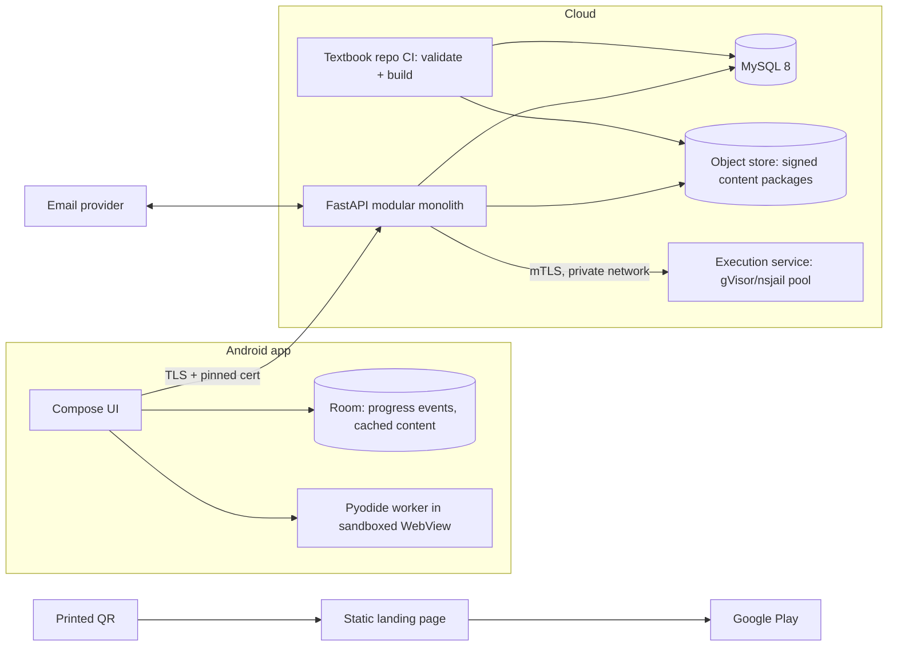
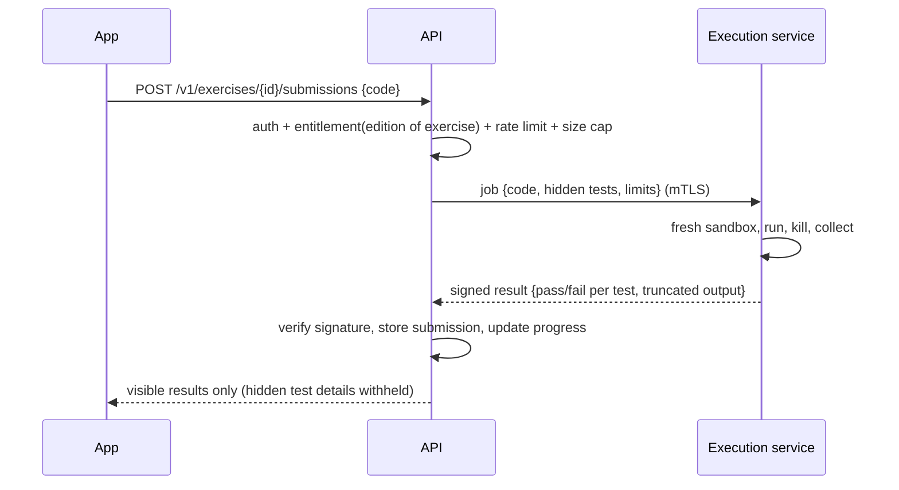
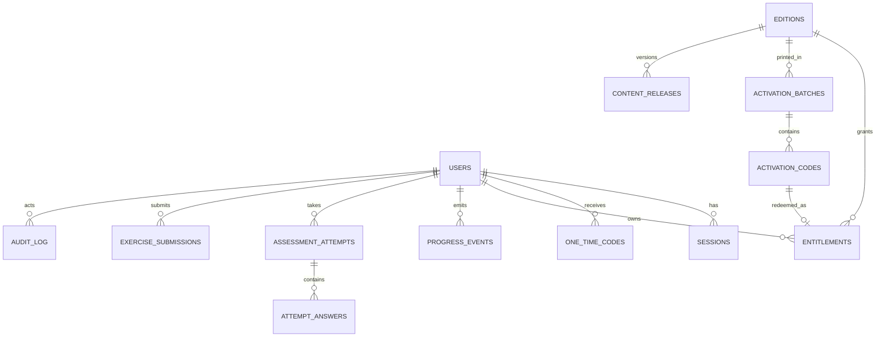

# Architecture (Phase 1 – proposed)

## 1. Components

Rules: the execution service has no route to the database or internet. The app never contacts it directly. Only the API holds the HMAC pepper and signing keys (secret manager, not env files in the repo).

## 2. Data flow – activation
```mermaid
sequenceDiagram
  participant S as Student app
  participant A as API
  participant D as MySQL 8
  S->>A: POST /v1/activation {code} (access token)
  A->>A: rate-limit(account, IP); verified email? check char valid?
  A->>D: BEGIN; UPDATE codes SET state='redeemed' WHERE hmac=? AND state='issued' RETURNING
  alt row updated
    A->>D: INSERT entitlement; INSERT audit; COMMIT
    A-->>S: 200 {entitlement}
  else none
    A->>D: INSERT audit(failed); COMMIT
    A-->>S: 400 generic failure + support ref
  end
```

## 3. Data flow – graded exercise


## 4. Data model

Key tables and constraints:
- `users(id CHAR(36) uuid, email lower-cased varchar unique, email_verified_at, pw_hash, created_at, disabled_at)`
- `sessions(id, user_id, family_id, refresh_hash unique, device_label, created_at, last_used_at, revoked_at, reuse_detected bool)`
- `one_time_codes(id, user_id/email, purpose{verify,reset}, code_hash, expires_at, attempts, used_at, sends)`
- `activation_codes(id, batch_id, code_hmac unique, state, redeemed_by, redeemed_at)`; partial index on `state='issued'`
- `entitlements(id, user_id, edition_id, activation_code_id unique, created_at, revoked_at)`; `unique(user_id, edition_id)`
- `content_releases(id, edition_id, version, manifest_hash, signed_at, min_app_version, status)`
- Protected content tables: `mcq_keys`, `trace_answers`, `exercise_tests(hidden)`, `solutions`, keyed by stable content IDs from the textbook repo.
- `progress_events(id CHAR(36) uuid PK client-generated, user_id, kind, content_id, payload JSON, client_ts, server_ts)`; `lesson_progress` is a derived view.
- `assessment_attempts(id, user_id, assessment_id, seed, started_at, expires_at, submitted_at, score, snapshot JSON, request_id unique per user)`; `attempt_answers(attempt_id, question_id, chosen, seq)`
- `exercise_submissions(id, user_id, exercise_id, code_hash, code, result JSON, created_at)`
- `audit_log(id, at, actor, action, object, outcome, ip_hash, ref)` append-only (no UPDATE/DELETE grants to the app role).
Database roles: the app role has no DDL rights; a separate migration role runs Alembic.

## 5. API surface (v1; OpenAPI will be generated from code in Phase 2)
| Endpoint | Auth | Entitlement | Notes |
|---|---|---|---|
| `POST /auth/register`, `/auth/verify-email`, `/auth/login`, `/auth/refresh`, `/auth/logout` | none/refresh | – | rate-limited; uniform errors |
| `POST /auth/forgot`, `/auth/reset` | none | – | enumeration-safe; reset revokes all sessions |
| `POST /activation` | access | – (verified email) | atomic redeem |
| `GET /me` | access | – | entitlement summary, resume position |
| `GET /content/manifest?edition=` | access | yes | edition validated against entitlements |
| `GET /content/files/{hash}` | access | yes | short-lived signed URL; ownership via manifest |
| `PUT /progress/events` (batch) | access | yes | idempotent by event UUID |
| `GET /progress` | access | yes | own data only |
| `POST /practice/items/{id}/answer` | access | yes | practice items only (MCQ and trace); verdict + why for that option; answer + explanation after a right answer or 2 wrong tries; rate-limited (built in A5) |
| `POST /assessments/{id}/attempts`, `PUT …/answers`, `POST …/submit`, `GET …/result` | access | yes | state machine (ADR 0009) |
| `POST /exercises/{id}/submissions` | access | yes | graded in sandbox |
| `GET /exercises/{id}/hint`, `/solution` | access | yes | policy-gated, logged |
Common: `user_id` is never accepted from the client; object IDs are checked against entitlement of the *object's* edition; request size caps; per-route rate limits; structured error format with support reference.

## 6. Offline matrix
| Capability | Offline | Requires network |
|---|---|---|
| Read downloaded lessons, examples, diagrams | ✔ | download |
| Run code locally (Pyodide) | ✔ | – |
| Progress/bookmark capture | ✔ queued | sync |
| Practice MCQ with explanation | ✘ | ✔ |
| Code tracing | ✔ (walkthrough) / check needs network | check |
| Graded submit, assessments, hints/solutions | ✘ | ✔ |
| Sign-in, activation, recovery | ✘ | ✔ |
Entitlement offline: the encrypted package key is cached after a successful online check and expires (e.g., 14 days) unless refreshed, so logout/revocation takes effect and offline access cannot outlive entitlement indefinitely.

## 7. Observability
Structured logs without secrets or raw codes; metrics for activation failures, refresh-reuse events, sandbox kills/timeouts, rate-limit hits; alerts on batch-level anomalies. Backups: MySQL 8 binlog PITR; restore tested in Phase 8.
