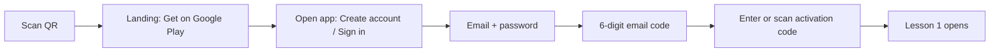

# Student journeys
Targets are measurable acceptance criteria, to be verified in usability tests (Phase 7).

## J1 First-time purchaser (target: ≤ 6 screens, ≤ 3 text fields in total)

Notes: no onboarding tour; the email code step is required for recovery to work (a typo'd email would strand the student). Activation field accepts paste, camera scan, tolerant formatting, and shows the check-character error instantly.

## J2 Returning student (target: 1 tap from launch to the exact lesson position)
Launch → Home shows one primary **Continue** button with "Unit 2 · Loops — Lesson 3" → lesson opens at the last position.

## J3 Studying a lesson (target: no navigation menus inside a lesson)
Topic page: Explanation → Example → "Try it" practice entries (MCQs / Trace / Code) → Next lesson. Everything is a vertical scroll with one primary button at the end.

## J4 Practising Python (target: ≤ 2 taps from lesson to editor)
Exercise → problem + starter code → **Run** (local) → output/errors in plain language → edit → **Check** (graded) → test results; hint button appears after first failed check.

## J5 Checking understanding
MCQ: choose → **Check** → verdict + explanation → **Next**. Practice shows feedback immediately; unit assessment shows none until **Submit**.

## J6 Changing phones
Install → Sign in → progress restored. No activation prompt because entitlement is on the account. If the device limit is exceeded, the oldest device is signed out with a plain message.

## Error and edge states (each has a designed message, not a raw error)
No network; slow network (after 8 s "still trying"); expired session (silent refresh, else one sign-in screen returning to where they were); wrong activation code (one generic message and "Need help?"); code already used; assessment interrupted (resume with timer rules); runner not ready ("Getting Python ready…" with progress, never blocking reading).
